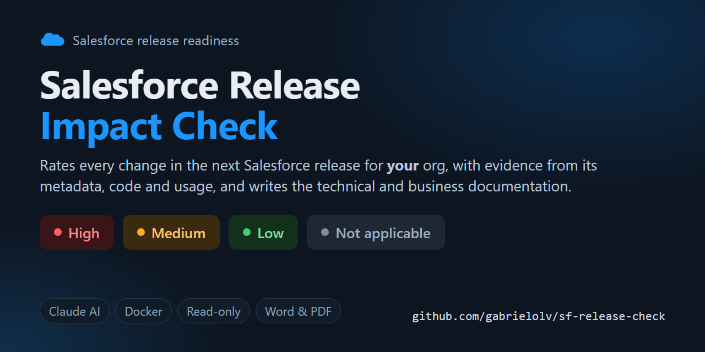

# Salesforce Release Impact Check



[](https://github.com/gabrielolv/sf-release-check/actions/workflows/docker-publish.yml)

Find out what the next Salesforce release means for **your** org before it lands.

You log in to a Salesforce org and upload the release notes. The tool then checks each of the roughly 1,700 release
changes against what the org actually uses: licenses, packages, metadata, API versions, logins and source code. It
rates each change **High**, **Medium**, **Low** or **Not Applicable** for that org, explains why, and gives the action
to take. You get two shareable documents in Word or PDF:

- **Technical**, for developers and architects: every High and Medium item with its evidence, the affected
  components, the actions and test notes, plus a developer task list.
- **Non-technical**, for managers, PMs and POs: the verdict, top risks, key dates, decisions needed, user-facing
  changes and a readiness plan.

The analysis is done by Claude. It runs in a web app on your own machine, and the org is only read, never changed.

```
Release notes (PDF / Word) ─► parse ─► ~1,700 changes ─┐
                                                       ├─► rule-based pre-check ─► Claude analysis ─► Word / PDF / HTML / Excel
Salesforce org ─► read-only inventory ─────────────────┘   (shortlist + evidence)   (rating, evidence, actions,
 (Log in with Salesforce)  licenses, packages, metadata,                             owners, summary per audience)
                           API versions, logins, source code
```

## Contents

- [What you need](#what-you-need)
- [Install and start (prebuilt Docker image)](#install-and-start-prebuilt-docker-image)
- [Using the app](#using-the-app)
- [Time and cost](#time-and-cost)
- [Update, stop and uninstall](#update-stop-and-uninstall)
- [Company networks (Zscaler, Netskope...)](#company-networks-zscaler-netskope)
- [Security and data handling](#security-and-data-handling)
- [Build the image from source](#build-the-image-from-source)
- [Command line (without Docker)](#command-line-without-docker)
- [Impact levels](#impact-levels) · [How it works](#how-it-works) · [Tuning](#tuning) · [Troubleshooting](#troubleshooting)
- [For maintainers: publishing a new image](#for-maintainers-publishing-a-new-image)

## What you need

| | |
|---|---|
| **Docker** | [Docker Desktop](https://www.docker.com/products/docker-desktop/) on Windows or macOS, or Docker Engine with Compose v2.24+ on Linux. On Windows, Docker Desktop uses WSL 2, which its installer sets up for you. You don't need to install a Linux distribution such as Ubuntu. |
| **A Salesforce login** | Use a user that has *API Enabled* and *View Setup and Configuration*. *View All Data* gives more complete record counts and login history. Start with a **sandbox**, ideally the preview sandbox of the coming release. |
| **Claude access** (one of these) | A **Claude account** on a Pro, Max, Team or Enterprise plan, with Claude Code enabled for your seat. Usage counts against your plan, so there is no extra bill. **Or** a **Claude API key** from [console.anthropic.com](https://console.anthropic.com), billed per use. |
| **The release notes** | The PDF of the coming release, from [help.salesforce.com](https://help.salesforce.com/s/articleView?id=release-notes.salesforce_release_notes.htm) > *Download PDF*. A Word (.docx) version works too. |

You don't need Python, the Salesforce CLI or Claude Code on your machine, because the image includes everything.

## Install and start (prebuilt Docker image)

The image is published on GitHub Container Registry as **`ghcr.io/gabrielolv/sf-release-check`**. It is public, so
you don't need to log in. Make sure Docker Desktop is running (the whale icon in the taskbar or menu bar), then pick
one of the options below.

> The app must be published on port **1717**, and you must open it as **http://localhost:1717**, not
> `127.0.0.1`. Salesforce sends you back to that exact address after you log in.

### Option A: Docker Compose (recommended)

You need the project folder. Either clone it, or use **Code > Download ZIP** on GitHub and unzip it.

```powershell
git clone https://github.com/gabrielolv/sf-release-check.git
cd sf-release-check
docker compose pull        # downloads the image (~1.2 GB on disk, first time only)
docker compose up -d       # starts the app in the background
```

Then open **http://localhost:1717**.

Analyses are saved in the `data/` folder next to the compose file, so they survive restarts and updates.

### Option B: a single `docker run` command (no project files)

**Windows (PowerShell)**

```powershell
docker run -d --name sf-release-check --restart unless-stopped `
  -p 127.0.0.1:1717:1717 -v sf-release-check-data:/data `
  ghcr.io/gabrielolv/sf-release-check:latest
```

**macOS / Linux**

```bash
docker run -d --name sf-release-check --restart unless-stopped \
  -p 127.0.0.1:1717:1717 -v sf-release-check-data:/data \
  ghcr.io/gabrielolv/sf-release-check:latest
```

Then open **http://localhost:1717**. Analyses are kept in the Docker volume `sf-release-check-data`.

### Option C: Docker Desktop window

1. Download the image once from a terminal: `docker pull ghcr.io/gabrielolv/sf-release-check:latest`. Docker
   Desktop's search box only searches Docker Hub, so the image won't show up there.
2. In Docker Desktop, go to **Images**, find `ghcr.io/gabrielolv/sf-release-check` and click **Run** (▶).
3. Open **Optional settings** and fill in:
   - **Container name:** `sf-release-check`
   - **Host port:** `1717`
   - **Volumes:** host path: a folder of your choice, for example `C:\sf-release-check-data`. Container path: `/data`.
4. Click **Run**, then open **http://localhost:1717**. You can start and stop it later from **Containers**.

> Option C publishes the port on all network interfaces, which Options A and B don't. On a shared or untrusted
> network, use A or B instead, because they make the app reachable from this computer only.

### Check it is running

`docker ps` should list the container as `healthy` after about 20 seconds. If the page doesn't load, run
`docker logs sf-release-check` (or `docker compose logs` for Option A).

## Using the app

The page walks you through five steps. Each step unlocks when the previous one is done.

1. **Log in to Salesforce.** This works like Workbench. Choose *Sandbox*, *Production* or *Custom domain* (My
   Domain URL), pick the API version, and click **Log in with Salesforce**. The normal Salesforce login page opens,
   where MFA and SSO work as usual, and you come back connected. The app only reads from the org.
2. **Connect Claude.** Choose one:
   - **Claude account:** open a terminal on any machine where Claude Code is installed (`npm i -g
     @anthropic-ai/claude-code`, or see [the Claude Code setup guide](https://docs.claude.com/en/docs/claude-code/setup)).
     Run `claude setup-token`, sign in with your Claude account in the browser, and paste the token it prints
     (`sk-ant-oat01-...`). The token is valid for about a year, and you can save it in `.env` so you don't need to
     paste it again (see [Settings](#settings-env)).
   - **Claude API key:** paste a key from the Anthropic Console. You set a spending cap for each analysis.

   Both are checked when you connect.
3. **Release notes.** Drag in the PDF or Word file. The page shows the release name (for example *Winter '27*) and
   how many changes were found.
4. **Analysis.** Choose the options:
   - **Claude model:** Opus 5.5 is recommended for the best judgement. Sonnet 5.5 is faster and cheaper.
   - **Parallel batches:** how many batches Claude reviews at once. This changes only how long the run takes, not the
     tokens or the cost. Lower it if you hit rate limits.
   - **Include unmanaged source code:** lets Claude check whether your Apex, Visualforce, LWC or Aura code uses a
     changed feature. Turn it off if code must not leave the company, which makes the analysis less precise.
   - **Rule-based only:** skips Claude completely. It's free and quick, but much less accurate.

   Click **Start analysis**. You see each stage live, a progress bar, the activity log, the elapsed time, the tokens
   used and the cost (for a Claude account, the API-equivalent value, which isn't billed). You can cancel at any time.
5. **Documentation.** When the run finishes, you get the High, Medium and Low counts, a one-paragraph verdict, and
   download buttons:
   - **Technical document** and **Non-technical document**, each in **Word** or **PDF**.
   - The **interactive HTML report**: one offline file with tabs for Overview, Product, Architecture, Developers,
     All changes (searchable), Org profile and Method.
   - The **Excel action list**: action items with owners, effort and deadlines, plus every change with filters.

Previous analyses stay listed at the bottom, so you can download their documents again without re-running.

### Settings (`.env`)

All settings are optional. Copy [.env.example](.env.example) to `.env` next to `docker-compose.yml` and restart with
`docker compose up -d`. With `docker run`, pass the same settings with `--env-file .env`.

| Variable | Purpose |
|---|---|
| `CLAUDE_CODE_OAUTH_TOKEN` | Your `claude setup-token` token, so step 2 is done automatically |
| `ANTHROPIC_API_KEY` | A Claude API key, used instead of the account token |
| `SF_CLIENT_ID` / `SF_CLIENT_SECRET` | Your own Salesforce External Client App, if the org blocks the default one (see [Troubleshooting](#troubleshooting)) |
| `RC_MAX_UPLOAD_MB` | Maximum size of an uploaded release-notes file (default 200) |

The `.env` file is git-ignored. Don't commit tokens or keys.

## Time and cost

Measured on a real org with the Winter '27 release notes (1,658 changes, 713 shortlisted for Claude, 15 batches,
Opus 5.5, 4 parallel batches):

| | |
|---|---|
| Duration | about **13 minutes**: org inventory and pre-check take about 1 minute, Claude takes about 12 |
| Tokens | about **8 million**. Most of them (6.6 million) are cached re-reads of the rules and the org profile, which cost 5% of the normal input price. |
| Cost | about **$16 API-equivalent**. With a Claude account it isn't billed and counts against your plan's usage limits instead. With an API key it is billed, and the spending cap stops the run if it is reached. |

A bigger org or more shortlisted changes means more batches. Sonnet 5.5 costs about half as much as Opus.

## Update, stop and uninstall

| | Docker Compose (Option A) | `docker run` (Options B and C) |
|---|---|---|
| Update to the latest version | `docker compose pull` then `docker compose up -d` | `docker pull ghcr.io/gabrielolv/sf-release-check:latest`, then `docker rm -f sf-release-check` and run the same `docker run` command again |
| Stop | `docker compose down` | `docker stop sf-release-check` |
| Start again | `docker compose up -d` | `docker start sf-release-check` |
| Remove everything | `docker compose down`, then delete the `data/` folder | `docker rm -f sf-release-check`, then `docker volume rm sf-release-check-data` |

Updating keeps your analyses. To pin a specific version, replace `latest` with a version tag such as `1.0.0`. The
tags are listed on the [package page](https://github.com/gabrielolv/sf-release-check/pkgs/container/sf-release-check).

## Company networks (Zscaler, Netskope...)

Some networks inspect HTTPS traffic and re-sign it with a company certificate. Docker containers don't trust that
certificate, so the app fails with `CERTIFICATE_VERIFY_FAILED`, or can't connect to Claude or Salesforce. The fix
takes one step: export the company root certificate into the `certs/` folder and restart the app. The container
trusts it from then on. See [certs/README.md](certs/README.md) for the export command on Windows and macOS.

With Option B, also add `-v "${PWD}/certs:/certs:ro"` to the `docker run` command.

## Security and data handling

Read this before running the tool on a client org.

- **The org is read-only.** Nothing is written to Salesforce. The app only runs queries, and Claude can only run
  `SELECT` queries, with a limit per batch.
- **No record data is collected.** The app reads counts and metadata only, never customer or patient records.
- **What is sent to Claude:** the org profile (component names and counts, connected apps, sites, login types and
  API versions) and, unless you turn it off, **excerpts of unmanaged source code**. Check that the client's data and
  AI policy allows this. If it doesn't, untick *Include unmanaged source code*, or choose *Rule-based only* so that
  nothing leaves your machine.
- **Secrets stay in memory.** Salesforce tokens and the Claude token or key are never written to disk or logs. They
  are gone when the container stops, and *Log out* revokes the Salesforce session.
- **The app is local only.** It is published on `127.0.0.1`, so other computers can't reach it (Options A and B).
- **Analyses contain org metadata and source code.** They are stored in `data/`, or the Docker volume. Delete a run
  from the history table when you no longer need it, and share only the generated documents.

### How "Log in with Salesforce" works

It uses the OAuth 2.0 web server flow with PKCE, the same way the Salesforce CLI logs in. The default client is
the Salesforce CLI's global connected app (`PlatformCLI`), which every org already has, so nothing needs to be set up
in the org. That app's callback is fixed at `http://localhost:1717/OauthRedirect`, which is why the port is 1717.

### Why the Claude account uses a token and not a "Log in with Claude" button

Anthropic doesn't allow third-party apps to offer their own claude.ai login. The supported route is to sign in
with the official Claude Code client. `claude setup-token` does the browser login on your machine and gives you a
long-lived token for your plan. The app then runs Claude Code, which is included in the image, with that token.

## Build the image from source

Use this if you change the code, or if you can't pull from ghcr.io:

```powershell
git clone https://github.com/gabrielolv/sf-release-check.git
cd sf-release-check
docker compose up -d --build     # ~3 minutes the first time
```

On a network that inspects HTTPS, put the certificate in `certs/` first, because the build downloads Python
packages and Claude Code.

## Command line (without Docker)

The same analysis can run from a terminal, using the Salesforce CLI and Claude Code installed on your machine. It
produces the HTML report, the Excel file, a Markdown file and the four documents.

**Prerequisites:** Python 3.10+, the [Salesforce CLI](https://developer.salesforce.com/tools/salesforcecli) (`sf`),
and [Claude Code](https://docs.claude.com/en/docs/claude-code/setup), signed in. The Claude Code VS Code or Cursor
extension also works, because its bundled CLI is found automatically.

1. Put the release notes PDF in [Release Note/](Release%20Note/).
2. Run `.\run.ps1` on Windows or `./run.sh` on macOS and Linux. The launcher installs the Python packages.
3. Pick an org that is already authenticated on your machine, or choose *Log in to a different org*, which opens the
   browser. Expired sessions are detected and you are asked to log in again.
4. Open the results in `output/<run>/report/`.

| Command | Purpose |
|---|---|
| `.\run.ps1 --target-org MYSANDBOX` | Skip the org menu |
| `.\run.ps1 --no-ai` | Rule-based ratings only, with no Claude call |
| `.\run.ps1 --engine api --budget 30` | Use the Claude API (`ANTHROPIC_API_KEY`) instead of Claude Code, with a spending cap |
| `.\run.ps1 --model claude-sonnet-5-5` | Choose the Claude model |
| `.\run.ps1 --parallel 5` | Run more AI batches at once |
| `.\run.ps1 --skip-source` | Don't download unmanaged Apex, VF, LWC or Aura source |
| `.\run.ps1 --resume output\<run>` | Continue a run, for example after a batch failed. Batches that finished are reused. |
| `.\run.ps1 --report-only output\<run>` | Re-render the report after editing `ai/assessments.json` |

In Claude Code, opened in this folder, you can also type `/sf-release-impact`. Claude then runs the check, and you
can ask it questions about the results, such as "why is X High?" or "list the developer tasks for Experience Cloud".

## Impact levels

| Level | Meaning | Expected action |
|---|---|---|
| **High** | A breaking, mandatory or security change to something the org demonstrably uses, with a hard date. Examples: retirements, enforced release updates, removed APIs or methods that the code references. | Must be done before the production upgrade |
| **Medium** | Existing behavior changes, or work is required. Examples: changes that are on by default, future enforcement, deprecations, changes tied to an API version. | Test in the preview sandbox, communicate the change and plan a backlog item |
| **Low** | An optional or additive change in an area the org uses | None required, but it may be an opportunity |
| **Not Applicable** | The product, license or edition isn't in the org | None |

The full rubric is in [.claude/skills/sf-release-impact/references/impact-rubric.md](.claude/skills/sf-release-impact/references/impact-rubric.md).

## How it works

| Step | Module | What happens |
|---|---|---|
| 1 | [webapp/salesforce_oauth.py](webapp/salesforce_oauth.py) (web), [scripts/rc/sfcli.py](scripts/rc/sfcli.py) (CLI) | Salesforce login and session handling |
| 2 | [scripts/rc/parse_release_notes.py](scripts/rc/parse_release_notes.py) | Splits the PDF or Word file into individual changes, using the heading styles and page footers to find each product area. Drops changelogs, highlight recaps and availability tables. |
| 3 | [scripts/rc/org_inventory.py](scripts/rc/org_inventory.py) | **Read-only** REST and Tooling API queries: organization, licenses, packages, record counts, metadata counts and API versions, flows by type, connected apps, named credentials, sites, login types and API versions (last 30 days), and unmanaged source code. Works out which capabilities are in use from [config/capabilities.json](config/capabilities.json). |
| 4 | [scripts/rc/prefilter.py](scripts/rc/prefilter.py) | Scores every change for relevance (product area, keywords, code references) and severity ([config/impact_rules.json](config/impact_rules.json)), and builds the shortlist for Claude |
| 5 | [scripts/rc/ai_analysis.py](scripts/rc/ai_analysis.py) (Claude account, through Claude Code), [scripts/rc/ai_api.py](scripts/rc/ai_api.py) (API key) | Claude reviews the shortlist in batches. It checks the evidence with read-only tools (SOQL, source search, release-notes lookup), then gives the final rating, rationale, actions, owners, effort, deadline and test notes. It ends with a summary for each audience. Both engines follow the same rules in [.claude/skills/sf-release-impact/references/](.claude/skills/sf-release-impact/references/). |
| 6 | [scripts/rc/report.py](scripts/rc/report.py), [scripts/rc/docs.py](scripts/rc/docs.py) | Produces the HTML report, the Excel file and the Markdown file, and the technical and non-technical documents in Word and PDF |
| - | [webapp/](webapp/) | FastAPI web app: background runs with live progress ([jobs.py](webapp/jobs.py)) and the page ([static/](webapp/static/)) |

Each run keeps everything it produced in its own folder: the inputs, the intermediate JSON and the AI logs. You can
audit and reproduce the results from there.

## Tuning

- **Wrong "not applicable" or a new product:** edit [config/capabilities.json](config/capabilities.json). It sets how
  each capability is detected in the org, and which release-note areas and keywords map to it.
- **Severity phrases:** edit [config/impact_rules.json](config/impact_rules.json).
- **Rating policy and writing style:** edit the files in
  [.claude/skills/sf-release-impact/references/](.claude/skills/sf-release-impact/references/).

After a change, rebuild the image with `docker compose up -d --build`, or push to `main` so that GitHub publishes a
new image.

## Troubleshooting

| Symptom | Fix |
|---|---|
| The page doesn't open | Check that Docker Desktop is running and that `docker ps` shows the container. Use `http://localhost:1717`, not `127.0.0.1`. |
| `port is already allocated` | Something else is using port 1717, most often `sf org login web` or another copy of this app. Close it, or run `docker ps` and stop the other container. The port can't be changed, because Salesforce sends you back to it after login. |
| `denied` or `unauthorized` when pulling the image | Run `docker logout ghcr.io` and pull again. An old ghcr.io login can block anonymous pulls. |
| Salesforce login fails with `OAUTH_APP_BLOCKED` or *app not approved* | The org blocks the Salesforce CLI connected app. Ask the admin to create an External Client App with the callback `http://localhost:1717/OauthRedirect`, the OAuth scopes *Manage user data via APIs (api)* and *Perform requests at any time (refresh_token)*, and PKCE enabled. Then put its consumer key in `.env` as `SF_CLIENT_ID`. |
| `CERTIFICATE_VERIFY_FAILED`, or Claude or Salesforce can't be reached | Your network inspects HTTPS. See [Company networks](#company-networks-zscaler-netskope). |
| The Claude account is rejected | Create a new token with `claude setup-token`. If the message says Claude Code isn't enabled, ask your Claude Team or Enterprise admin to enable it for your seat. |
| Rate-limit errors in the activity log, or batches marked *not completed* | Lower *Parallel batches* and start a new analysis. Rate-limited calls are retried automatically, and a failed batch is retried once, so a few errors in the log are normal. |
| "*N* queries skipped" in the org inventory | The user is missing a permission, or the edition doesn't have the feature. This is usually harmless. The details are in the run's `org/org_inventory.json` > `warnings`. |
| `wsl --install` fails downloading Ubuntu (`WININET_E_CONNECTION_RESET`) | Docker Desktop needs only WSL 2 itself (`wsl --version` shows whether it's installed), not Ubuntu. Run `wsl --install --no-distribution` and start Docker Desktop. |
| On Linux, the app can't write to `data/` | Run `mkdir -p data && sudo chown 10001 data`. The container runs as user 10001. |
| A new release's PDF gives far fewer changes than expected | Winter '27 gives about 1,670. If the count is much lower, Salesforce changed the PDF layout: open an issue and attach the PDF's name and page count. |

## For maintainers: publishing a new image

[.github/workflows/docker-publish.yml](.github/workflows/docker-publish.yml) builds the image for `linux/amd64` and
`linux/arm64` (Apple silicon) and publishes it to `ghcr.io/gabrielolv/sf-release-check`:

| Trigger | Tags published |
|---|---|
| Push to `main` | `latest`, `sha-<commit>` |
| Push a tag `v1.2.0` (`git tag v1.2.0 && git push --tags`) | `1.2.0`, `1.2`, `sha-<commit>` |
| Pull request | Build only, nothing published |

After the first publish, check the package visibility: on GitHub, go to **Profile > Packages > sf-release-check >
Package settings > Change visibility > Public**. A new package can start as private even when the repository is
public, and then teammates get `denied` when they pull.

Project conventions for contributors and for Claude Code are in [CLAUDE.md](CLAUDE.md).
